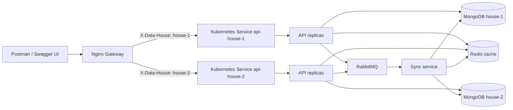

# Laborator: API Gateway, MongoDB, sincronizare și scalare

Ghidul descrie cum pornești laboratorul în Minikube și cum demonstrezi cerințele prin Swagger UI, Postman și `kubectl`.

## 1. Arhitectură

Fiecare **nod de date** este o pereche formată dintr-un API Node.js și o instanță MongoDB separată. „Nod de date” este doar numele folosit în acest laborator pentru perechea API–MongoDB.



**Rutarea și load balancing-ul au roluri diferite:** Nginx verifică `X-API-Key` și alege house-ul după `X-Data-House`. Apoi Service-ul Kubernetes distribuie conexiunile între replicile API ale house-ului ales. În această configurație nu se face round-robin între bazele house-urilor. Distribuirea Kubernetes nu promite o secvență strictă de tipul pod 1, pod 2, pod 3.

Bazele MongoDB sunt independente. Serviciul de sincronizare copiază modificările între ele; fiecare house are o bază proprie. Nu se folosește sharding sau MongoDB Replica Set.

## 2. Pornire inițială

Ai nevoie de `minikube`, `kubectl`, `helm` și Docker. Generează o cheie locală o singură dată:

```bash
openssl rand -hex 32
```

Copiază rezultatul în `~/.zshrc`, apoi încarcă variabila:

```bash
export LAB_API_KEY='valoarea-generata'
source ~/.zshrc
```

Pentru o singură sesiune, poți folosi `export LAB_API_KEY='valoarea-generata'` doar în terminalul curent. Chart-ul nu are cheie implicită.

Din directorul proiectului, pornește Minikube, construiește imaginile și instalează chart-ul:

```bash
minikube start
minikube image build -t pad-api:0.1.0 ./api
minikube image build -t pad-sync:0.1.0 ./sync-service
helm upgrade --install laborator ./charts/laborator \
  --namespace laborator --create-namespace \
  --set-string security.apiKey="$LAB_API_KEY"
kubectl get pods -n laborator -w
```

Așteaptă ca podurile să fie `Running` și `Ready`. Pentru gateway, pornește port-forward-ul într-un al doilea terminal și lasă-l activ:

```bash
kubectl port-forward -n laborator service/gateway 8080:80
```

Gateway-ul este disponibil la `http://localhost:8080`. Pentru instalările ulterioare, transmite din nou cheia la `helm upgrade`:

```bash
helm upgrade laborator ./charts/laborator -n laborator \
  --set-string security.apiKey="$LAB_API_KEY"
```

Dacă ai schimbat configurația Nginx în chart, repornește gateway-ul după upgrade ca să reîncarce ConfigMap-ul:

```bash
kubectl rollout restart deployment/gateway -n laborator
kubectl rollout status deployment/gateway -n laborator
```

## 3. Demonstrarea API Gateway-ului și a API key-ului

Verificarea cheii se face în Nginx. Cheia ajunge din variabila `LAB_API_KEY` în Helm prin `--set-string security.apiKey=...`; chart-ul o pune într-un Secret Kubernetes, pe care Nginx îl montează. Nginx compară headerul primit cu cheia din Secret. La succes, rutează cererea după `X-Data-House` și elimină `X-API-Key` înainte să trimită cererea API-ului.

În [gateway.yaml](charts/laborator/templates/gateway.yaml) este configurată verificarea/rutarea; [secret.yaml](charts/laborator/templates/secret.yaml) definește secretul și regula de comparare.

Din Postman sau terminal, demonstrează respingerea unei cereri fără cheie:

```bash
curl -i http://localhost:8080/books \
  -H 'X-Data-House: house-1'
```

Răspunsul așteptat este `401 Unauthorized`. Cu cheia corectă, cererea ajunge la API:

```bash
curl -i http://localhost:8080/books \
  -H "X-API-Key: $LAB_API_KEY" \
  -H 'X-Data-House: house-1' \
  -H 'Accept: application/json'
```

`X-API-Key` este o cheie comună pentru house-uri. API-urile nu o verifică separat; accesul clientului trece prin gateway. Serviciile API sunt interne clusterului, dar cineva cu acces la cluster le poate apela direct și ocoli gateway-ul. Secret-urile Kubernetes și istoricul Helm trebuie protejate prin acces RBAC adecvat.

## 4. Swagger UI și Postman

Deschide `http://localhost:8080/docs/`. Ruta `/docs` redirecționează la `/docs/`, iar interfața și specificația OpenAPI sunt accesibile fără cheie pentru a se putea încărca în browser. Operațiile CRUD rămân protejate.

În Swagger UI:

1. Apasă **Authorize**.
2. La `ApiKeyAuth`, introdu valoarea reală a lui `LAB_API_KEY` — fără prefixul `Bearer`.
3. La `DataHouse`, introdu `house-1` sau `house-2`.
4. Apasă **Authorize**, apoi **Close**. Alege o operație, apasă **Try it out**, apoi **Execute**.

Specificația brută este la `http://localhost:8080/openapi.json` și se poate importa în Postman. Pentru cereri directe în Postman, folosește URL-ul `http://localhost:8080` și adaugă headerele:

| Header | Valoare |
| --- | --- |
| `X-API-Key` | valoarea reală din `LAB_API_KEY` |
| `X-Data-House` | `house-1` sau `house-2` |
| `Accept` | `application/json` sau `application/xml` |

Postman nu preia automat variabila din `~/.zshrc`; introdu cheia în valoarea headerului sau într-o variabilă locală Postman. Nu include cheia reală într-o colecție partajată.

## 5. Operațiile CRUD

Resursa demonstrativă este `books`. Rutele descriu resurse, iar operația este indicată de metoda HTTP.

| Metodă | Rută | Descriere |
| --- | --- | --- |
| `GET` | `/books` | Listează cărțile |
| `GET` | `/books/:id` | Citește o carte |
| `POST` | `/books` | Creează o carte |
| `PUT` | `/books/:id` | Creează sau înlocuiește cartea cu ID-ul indicat |
| `PATCH` | `/books/:id` | Modifică parțial o carte existentă |
| `DELETE` | `/books/:id` | Marchează cartea ca ștearsă și propagă tombstone-ul |

Pentru `POST`, selectează **Body → raw → JSON** și trimite `Content-Type: application/json`:

```json
{
  "title": "Dune",
  "author": "Frank Herbert",
  "isbn": "9780441172719"
}
```

Pentru XML, folosește `Content-Type: application/xml` și body-ul:

```xml
<book><title>Dune</title><author>Frank Herbert</author><isbn>9780441172719</isbn></book>
```

Headerul `Accept` selectează formatul răspunsului. API-ul răspunde cu `415` pentru un `Content-Type` neacceptat și cu `406` pentru un `Accept` neacceptat. Pentru prioritate, trimite `X-Priority: high`; valoarea implicită este `normal`.

## 6. Sincronizarea datelor și rolul RabbitMQ

Sincronizarea are loc atunci când o modificare trece prin API. De exemplu, la crearea unei cărți:

1. API-ul `house-1` salvează cartea în MongoDB-ul lui.
2. API-ul trimite în RabbitMQ un mesaj care descrie schimbarea: ID-ul cărții, datele ei și house-ul de origine.
3. Serviciul de sincronizare citește mesajul din coadă și aplică aceeași schimbare în bazele tuturor house-urilor.
4. Serviciul invalidează cache-ul Redis pentru cartea modificată.

La modificare și ștergere se trimite tot un mesaj. Ștergerea se propagă ca marcaj de ștergere, ca toate bazele să o poată primi.

**RabbitMQ este intermediarul de mesaje, nu o bază de date.** API-ul pune schimbarea în coadă, iar serviciul de sincronizare o preia când poate. Astfel API-ul nu trebuie să apeleze fiecare bază direct; dacă serviciul de sincronizare este temporar ocupat, mesajul așteaptă în coadă. RabbitMQ păstrează mesajele până când consumatorul confirmă procesarea și permite prioritizarea cererilor `high` față de cele `normal`.

Sincronizarea este asincronă: bazele pot diferi câteva momente până când mesajul este procesat. La modificări concurente câștigă versiunea mai nouă; la egalitate se folosește ID-ul house-ului ca departajare.

**Important:** dacă inserezi sau modifici un document direct în MongoDB prin Compass sau `mongosh`, API-ul și RabbitMQ nu află despre schimbare, deci celelalte baze nu se sincronizează. Pentru laborator, folosește API-ul sau scriptul de populare de mai jos.

### Popularea și demonstrarea sincronizării

MongoDB folosește colecții, nu tabele. Scriptul [seed.sh](scripts/seed.sh) scrie cinci documente în colecția `books` prin API-ul `house-1`. ID-urile fixe și `PUT` fac scriptul repetabil:

```bash
sh scripts/seed.sh http://localhost:8080
```

Scriptul folosește `LAB_API_KEY` dacă este exportată. Pentru a testa alt house, poți seta `DATA_HOUSE_ID=house-2`.

Pentru a demonstra sincronizarea în Postman:

1. Creează sau modifică o carte prin `house-1` (`X-Data-House: house-1`).
2. Citește același ID prin `house-2` (`X-Data-House: house-2`).
3. Dacă mesajul încă așteaptă în coadă, repetă citirea după câteva secunde.

## 7. Demonstrarea cache-ului Redis

### Cum lucrează cache-ul

MongoDB rămâne sursa oficială a datelor. Redis păstrează temporar răspunsurile la citirile frecvente, ca API-ul să nu citească de fiecare dată din MongoDB. API-ul folosește modelul **cache-aside**:

1. La un `GET /books` sau `GET /books/:id`, API-ul caută mai întâi cheia corespunzătoare în Redis.
2. Dacă cheia există (**cache hit**), API-ul returnează valoarea din Redis.
3. Dacă nu există (**cache miss**), API-ul citește MongoDB, returnează rezultatul și îl salvează în Redis cu un TTL.
4. Când TTL-ul expiră, Redis elimină automat valoarea. Următoarea cerere recitește MongoDB și umple din nou cache-ul.

Cheile includ ID-ul house-ului, astfel încât un house să nu folosească din greșeală cache-ul altuia: `house-1:books:list` pentru listă și `house-1:books:<id>` pentru o carte. Cache-ul listei are TTL de `30` secunde, iar cache-ul unei cărți are TTL de `60` secunde.

La `POST`, `PUT`, `PATCH` sau `DELETE`, API-ul modifică MongoDB și șterge cheia cărții și cheia listei din cache-ul local. Mesajul RabbitMQ propagă modificarea; serviciul de sincronizare actualizează celelalte MongoDB-uri și invalidează cheile lor Redis. Astfel, următoarea citire reîncarcă datele actualizate din baza respectivă. Pentru că sincronizarea este asincronă, alt house poate servi pentru scurt timp o valoare veche până când primește mesajul și invalidează cache-ul.

API-ul indică folosirea cache-ului în headerul de răspuns `X-Cache`: `MISS` înseamnă că a citit din MongoDB și a pus rezultatul în Redis; `HIT` înseamnă că a returnat rezultatul din Redis. Headerul este adăugat pentru demonstrația de laborator.

Dacă ai deja clusterul pornit, reconstruiește imaginea API și repornește podurile ca să încarce headerul de diagnostic:

```bash
minikube image build -t pad-api:0.1.0 ./api
kubectl rollout restart deployment/api-house-1 deployment/api-house-2 -n laborator
kubectl rollout status deployment/api-house-1 -n laborator
kubectl rollout status deployment/api-house-2 -n laborator
```

În Postman, fă de două ori la rând `GET /books/000000000000000000000001` prin `house-1`. Prima cerere ar trebui să aibă `X-Cache: MISS`, iar a doua `X-Cache: HIT`. Pentru a repeta demonstrația de la zero, șterge mai întâi cheia din Redis:

```bash
kubectl exec -n laborator deployment/redis -- \
  redis-cli DEL 'house-1:books:000000000000000000000001'
```

Poți verifica existența și timpul rămas până la expirare (TTL):

```bash
kubectl exec -n laborator deployment/redis -- \
  redis-cli EXISTS 'house-1:books:000000000000000000000001'
kubectl exec -n laborator deployment/redis -- \
  redis-cli TTL 'house-1:books:000000000000000000000001'
```

`EXISTS` ar trebui să întoarcă `1`, iar `TTL` un număr pozitiv de secunde, de maximum `60`. Lista de cărți folosește cheia `house-1:books:list` cu TTL de maximum `30` de secunde.

Pentru a demonstra invalidarea, fă `GET` pe o carte ca să obții `X-Cache: HIT`, apoi modific-o prin `PUT` sau `PATCH`. Cheia ei și cheia listei din house-ul sursă sunt șterse. După sincronizare, cache-ul este invalidat și în celelalte house-uri. Următorul GET va întoarce `X-Cache: MISS`.

## 8. Demonstrarea priorității

Trimite cereri CRUD cu `X-Priority: normal`, apoi cu `X-Priority: high`. API-ul mapează valorile la prioritățile RabbitMQ `5` și `10`; coada `sync.events` este declarată cu prioritate maximă `10`, iar sync service consumă un mesaj pe rând.

Poți demonstra configurarea cozii cu:

```bash
kubectl exec -n laborator rabbitmq-0 -- \
  rabbitmqctl list_queues name arguments
```

Prioritatea schimbă ordinea mesajelor care așteaptă în coadă; nu întrerupe un mesaj deja procesat.

## 9. Scalarea replicilor API și verificarea load balancing-ului

Pentru a testa load balancing-ul **în interiorul unui house**, scalează API-ul la trei poduri. Acest lucru nu creează baze MongoDB noi: replicile acelui API folosesc aceeași bază a house-ului.

Codul API adaugă headerul de diagnostic `X-API-Pod`, care identifică podul ce a răspuns. După modificarea codului, reconstruiește imaginea și aplică scalarea:

```bash
minikube image build -t pad-api:0.1.0 ./api
helm upgrade laborator ./charts/laborator -n laborator \
  --reuse-values --set api.replicas=3 \
  --set-string security.apiKey="$LAB_API_KEY"
kubectl rollout restart deployment/api-house-1 deployment/api-house-2 -n laborator
kubectl rollout status deployment/api-house-1 -n laborator
kubectl rollout status deployment/api-house-2 -n laborator
```

Verifică faptul că Service-ul `api-house-1` are trei endpointuri:

```bash
kubectl get endpointslices -n laborator \
  -l kubernetes.io/service-name=api-house-1
```

Apoi repetă cereri prin gateway și urmărește răspunsul `X-API-Pod`:

```bash
i=1
while [ "$i" -le 20 ]; do
  curl -sS -D - -o /dev/null \
    -H "X-API-Key: $LAB_API_KEY" \
    -H 'X-Data-House: house-1' \
    -H 'Accept: application/json' \
    http://localhost:8080/books | grep -i '^X-API-Pod:'
  i=$((i + 1))
done
```

Valori `X-API-Pod` diferite arată că cererile au ajuns la poduri API diferite. Nginx selectează `house-1`; distribuirea între podurile acelui house este făcută de Service-ul Kubernetes și nu este garantată într-o ordine fixă.

## 10. Adăugarea unui nod API–MongoDB nou

Pentru o bază nouă, adaugă un ID DNS valid în `dataHouses` din [values.yaml](charts/laborator/values.yaml):

```yaml
dataHouses:
  - id: house-1
  - id: house-2
  - id: house-3
```

Aplică chart-ul cu cheia:

```bash
helm upgrade laborator ./charts/laborator -n laborator \
  --set api.replicas=3 \
  --set-string security.apiKey="$LAB_API_KEY"
kubectl get pods -n laborator -w
kubectl get pvc -n laborator
```

În exemplu, `api.replicas=3` păstrează scalarea din secțiunea anterioară. Dacă nu ai scalat API-urile, elimină acea opțiune sau setează valoarea dorită în `values.yaml`.

Helm generează pentru `house-3` un Deployment și Service API, plus un StatefulSet MongoDB cu volum persistent. Actualizează și ruta Nginx și lista de ținte a sync service-ului. Serviciile sunt create asincron de Kubernetes; așteaptă până devin `Ready`. Toate house-urile folosesc aceeași imagine API.

## 11. Apelarea directă a unui API

Pentru a demonstra diferența dintre accesul prin gateway și accesul intern direct, poți face port-forward către API:

```bash
kubectl port-forward -n laborator service/api-house-1 3001:3000
```

Apoi apelează `http://localhost:3001/books`. Nu ai nevoie de `X-API-Key` sau `X-Data-House`: cererea ocolește Nginx, iar API-ul nu verifică cheia separat. Acesta este un exemplu pentru laborator și necesită acces la cluster; fluxul normal al clientului este prin gateway.

## Securitate și limitări

- Pentru laborator se folosește `kubectl port-forward` către `localhost`. Nu expune API-ul prin HTTP pe o rețea publică; cheia din header are nevoie de HTTPS/TLS în tranzit.
- `~/.zshrc` păstrează cheia în text simplu. Nu comite cheia în Git și nu partaja capturi sau colecții Postman care o conțin.
- Kubernetes Secret și valorile release-ului Helm trebuie protejate prin RBAC; Secret-urile Kubernetes nu sunt un manager de secrete.
- Baza este câte o instanță MongoDB standalone per house. Nu există failover nativ MongoDB Replica Set.
- `helm uninstall laborator -n laborator` elimină release-ul, dar PVC-urile pot rămâne; ștergerea lor elimină datele persistente.
