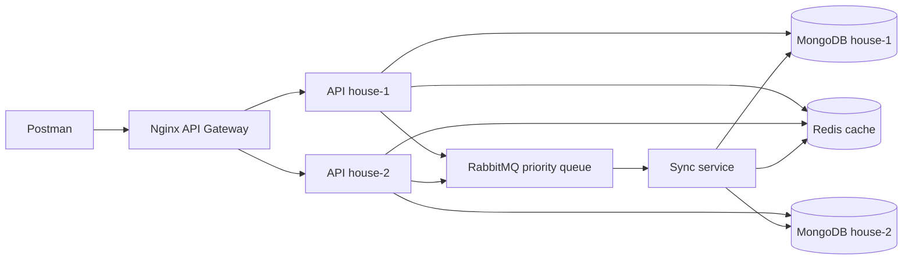

# Laborator: API-uri, MongoDB, gateway și sincronizare

## Scop

Laboratorul demonstrează mai multe perechi API–MongoDB, rutate printr-un gateway și sincronizate printr-un microserviciu. Întreaga infrastructură de laborator este instalată în Minikube cu un singur chart Helm.

Fiecare **nod de date** este o pereche formată dintr-un API Node.js și o instanță MongoDB proprie. „Nod de date” este termenul folosit aici pentru această pereche; nu este un obiect Kubernetes sau MongoDB standard.

## Arhitectură



Chart-ul principal este [charts/laborator](charts/laborator). Lista `dataHouses` din `values.yaml` este sursa de configurare pentru perechile API–MongoDB, rutele gateway-ului și țintele serviciului de sincronizare.

| Componentă | Rol |
| --- | --- |
| Minikube | Cluster Kubernetes local. Se pornește separat de Helm. |
| Helm chart `laborator` | Creează gateway-ul, Redis, RabbitMQ, serviciul de sincronizare și câte o pereche API–MongoDB pentru fiecare intrare `dataHouses`. |
| Nginx | Gateway HTTP, verifică `X-API-Key` și rutează după `X-Data-House`. Service-ul Kubernetes distribuie traficul între replicile API ale aceluiași house. |
| MongoDB | Câte o instanță separată per house, cu volum persistent. Nu se folosește sharding sau MongoDB Replica Set. |
| RabbitMQ | Coada durabilă `sync.events`; mesajele cu prioritate înaltă sunt procesate înaintea celor normale. |
| Microserviciul de sincronizare | Consumă evenimentele și propagă documentele către toate bazele. Invalidează și cache-ul corespunzător din Redis. |
| Redis | Cache cu TTL pentru citiri; invalidare după modificări locale și după sincronizare. |

## Pornirea în Minikube

Este necesar să fie instalate `minikube`, `kubectl`, `helm` și Docker. Generează cheia o singură dată:

```bash
openssl rand -hex 32
```

Copiază rezultatul într-o linie din `~/.zshrc`, apoi reîncarcă fișierul:

```bash
export LAB_API_KEY='valoarea-generata'
source ~/.zshrc
```

Pentru o singură sesiune, poți rula `export LAB_API_KEY='valoarea-generata'` doar în terminalul curent. Construiește imaginile aplicației direct în Minikube și instalează chart-ul:

```bash
minikube start
minikube image build -t pad-api:0.1.0 ./api
minikube image build -t pad-sync:0.1.0 ./sync-service
helm upgrade --install laborator ./charts/laborator \
  --namespace laborator --create-namespace \
  --set-string security.apiKey="$LAB_API_KEY"
kubectl get pods -n laborator
```

Chart-ul nu are o cheie implicită. Instalarea eșuează dacă `LAB_API_KEY` este goală. Nu comite cheia în Git. `~/.zshrc` este o soluție comodă pentru laboratorul local; pentru un mediu partajat sau de producție folosește un manager de secrete.

Chart-ul creează implicit `house-1` și `house-2`. Pentru Postman, deschide un tunel local într-un terminal:

```bash
kubectl port-forward -n laborator service/gateway 8080:80
```

Gateway-ul va fi disponibil la `http://localhost:8080`. Cheia este injectată în Secret-ul Kubernetes la instalarea chart-ului și nu este păstrată în `values.yaml`.

### Adăugarea unui nod de date

Adaugă un identificator DNS valid în `charts/laborator/values.yaml`:

```yaml
dataHouses:
  - id: house-1
  - id: house-2
  - id: house-3
```

Aplică din nou chart-ul și transmite cheia API:

```bash
helm upgrade laborator ./charts/laborator -n laborator \
  --set-string security.apiKey="$LAB_API_KEY"
kubectl get pods -n laborator
```

Helm creează MongoDB, API-ul și serviciul house-ului nou și actualizează lista de rutare a gateway-ului și țintele microserviciului de sincronizare. Pentru fiecare MongoDB se solicită un volum persistent de `1Gi`, configurabil prin `mongodb.storage`.

## Verificarea API key la gateway

Cheia nu este citită automat de Helm din `~/.zshrc`. Linia `export LAB_API_KEY=...` face variabila disponibilă proceselor pornite din shell. Opțiunea `--set-string` o transmite explicit către Helm:

```bash
helm upgrade --install laborator ./charts/laborator \
  --namespace laborator --create-namespace \
  --set-string security.apiKey="$LAB_API_KEY"
```

Fluxul este următorul:

1. Helm pune valoarea primită în `.Values.security.apiKey`.
2. În `charts/laborator/templates/secret.yaml`, funcția `required` refuză instalarea dacă cheia lipsește. Template-ul creează Secret-ul Kubernetes și fișierul `api-key-map.conf`.
3. `charts/laborator/templates/gateway.yaml` montează fișierul Secret în containerul Nginx și îl include în configurația `http`.
4. Nginx compară headerul cererii `$http_x_api_key` cu cheia din fișier. Dacă se potrivesc, `$api_key_valid` devine `1`; altfel rămâne `0`.
5. În blocul `location /`, Nginx returnează `401` când `$api_key_valid = 0`. Doar cererile cu o cheie validă continuă la rutarea după `X-Data-House` și ajung la API.

Logica relevantă din configurația Nginx, simplificată, este:

```nginx
map $http_x_api_key $api_key_valid {
  default 0;
  "cheia-injectata-de-helm" 1;
}

location / {
  if ($api_key_valid = 0) { return 401; }
  # apoi se rutează cererea către API-ul indicat de X-Data-House
}
```

Cheia este comună pentru toate API-urile din laborator și este verificată o singură dată, la intrarea în gateway. API-urile nu sunt expuse direct printr-un port extern în configurația aceasta.

În Postman, trimite aceeași valoare ca header:

```http
X-API-Key: valoarea-din-LAB_API_KEY
```

API-urile nu fac o a doua verificare a cheii; accesul clientului trece prin Nginx Gateway. La rotirea cheii, rulează din nou `helm upgrade` cu noua valoare. Checksum-urile din Deployment determină Kubernetes să repornească pod-ul Nginx și să încarce configurația actualizată. Actualizează și valoarea folosită în Postman.

Un `401 Unauthorized` indică de obicei că headerul lipsește sau nu are exact valoarea transmisă la ultima instalare/actualizare Helm. Dacă instalarea chart-ului raportează că `security.apiKey` trebuie setată, verifică variabila fără să afișezi secretul: `test -n "$LAB_API_KEY" && echo "LAB_API_KEY este setată"`. Dacă nu este setată, reîncarcă `~/.zshrc`.

Pentru parolele MongoDB și RabbitMQ, poți folosi un fișier local de valori ignorat de Git. Nu adăuga secrete reale în `values.yaml`. Secret-ul Kubernetes oferă configurare separată de cod, dar accesul la obiectele Secret din cluster trebuie protejat prin RBAC.

## API REST

API-ul gestionează resursa `books`. Rutele folosesc substantive, iar operația este indicată prin metoda HTTP.

| Metodă | Rută | Acțiune |
| --- | --- | --- |
| `GET` | `/books` | Listează cărțile |
| `GET` | `/books/:id` | Citește o carte |
| `POST` | `/books` | Creează o carte |
| `PUT` | `/books/:id` | Creează sau înlocuiește cartea cu acel ID |
| `PATCH` | `/books/:id` | Modifică parțial o carte existentă |
| `DELETE` | `/books/:id` | Marchează cartea ca ștearsă și sincronizează tombstone-ul |

### Headere

Toate cererile API trec prin gateway și folosesc:

```http
X-API-Key: valoarea-din-LAB_API_KEY
X-Data-House: house-1
```

`X-Data-House` selectează API-ul și baza lui MongoDB. Pentru cereri de scriere, clientul indică formatul corpului și formatul dorit al răspunsului:

- JSON: `Content-Type: application/json`, `Accept: application/json`
- XML: `Content-Type: application/xml`, `Accept: application/xml`
- Prioritate: `X-Priority: high` sau `X-Priority: normal` (implicit)

Exemplu JSON:

```http
POST /books HTTP/1.1
Content-Type: application/json
Accept: application/json
X-API-Key: valoarea-din-LAB_API_KEY
X-Data-House: house-1
X-Priority: high

{"title":"Dune","author":"Frank Herbert","isbn":"9780441172719"}
```

Exemplu XML:

```http
POST /books HTTP/1.1
Content-Type: application/xml
Accept: application/xml
X-API-Key: valoarea-din-LAB_API_KEY
X-Data-House: house-2

<book><title>Dune</title><author>Frank Herbert</author><isbn>9780441172719</isbn></book>
```

Serverul răspunde cu `415` dacă `Content-Type` nu este JSON sau XML și cu `406` dacă formatul din `Accept` nu este suportat. Gateway-ul răspunde cu `401` pentru o cheie greșită și `400` dacă lipsește sau este necunoscut `X-Data-House`.

## Sincronizare și consistență

La fiecare scriere, API-ul actualizează baza locală și publică un eveniment durabil în RabbitMQ. Mesajul include ID-ul documentului, house-ul sursă, versiunea și documentul complet. Serviciul de sincronizare aplică documentul tuturor bazelor și nu republică evenimentul.

Procesarea este idempotentă. Documentele au metadate `_sync.version` și `_sync.origin`; în cazul modificărilor concurente câștigă versiunea mai mare, iar la egalitate se folosește identificatorul house-ului ca departajare. Ștergerea este reprezentată prin `_deleted: true` pentru ca operația să poată fi propagată. Citirile ascund documentele șterse.

Sincronizarea este **eventuală**: bazele pot diferi cât timp există mesaje în așteptare sau o bază este indisponibilă. Redis este invalidat și în house-urile care primesc modificarea sincronizată.

## Popularea datelor

MongoDB organizează datele în colecții, nu în tabele. Scriptul populează colecția `books` cu cinci documente prin API-ul `house-1`; fiecare operație publică un eveniment, iar serviciul de sincronizare le propagă către celelalte baze. ID-urile fixe și metoda `PUT` fac scriptul idempotent.

```bash
sh scripts/seed.sh http://localhost:8080
```

Pentru alt API/data house, setează `DATA_HOUSE_ID`:

```bash
DATA_HOUSE_ID=house-2 sh scripts/seed.sh http://localhost:8080
```

Dacă ai schimbat cheia API:

```bash
API_KEY="$LAB_API_KEY" sh scripts/seed.sh http://localhost:8080
```

## Verificare din Postman

Configurează `baseUrl` ca `http://localhost:8080` și trimite headerele `X-API-Key` și `X-Data-House`. Verifică CRUD-ul, variantele JSON/XML, prioritățile `high`/`normal`, apoi citește aceeași carte prin fiecare house pentru a observa sincronizarea. Pentru a verifica invalidarea cache-ului, citește documentul printr-un house, modifică-l prin altul și citește-l din nou.

## Limite ale configurației de laborator

- Fiecare MongoDB este o instanță standalone cu volum persistent; aceasta nu oferă failover nativ de Replica Set.
- Sincronizarea dintre baze este asincronă și poate avea întârzieri.
- Parolele implicite sunt doar pentru laborator local.
- `helm uninstall laborator -n laborator` elimină resursele release-ului; volumele persistente StatefulSet pot rămâne. Ștergerea PVC-urilor șterge datele de laborator.
- Chart-ul țintește Minikube local. Nu este o configurație de producție.
